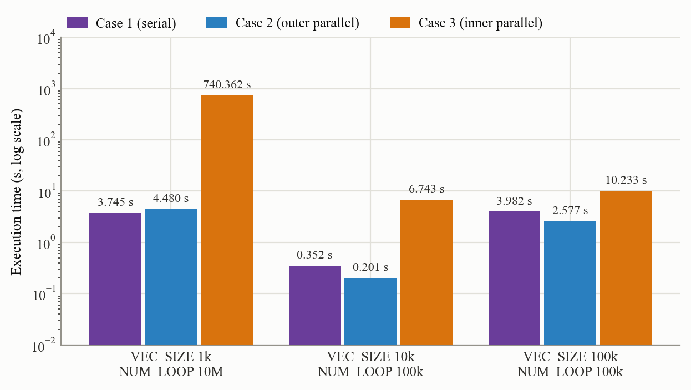
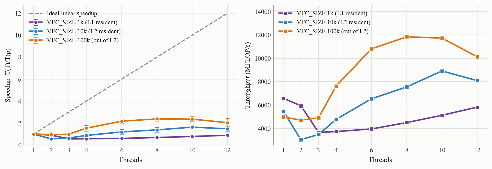
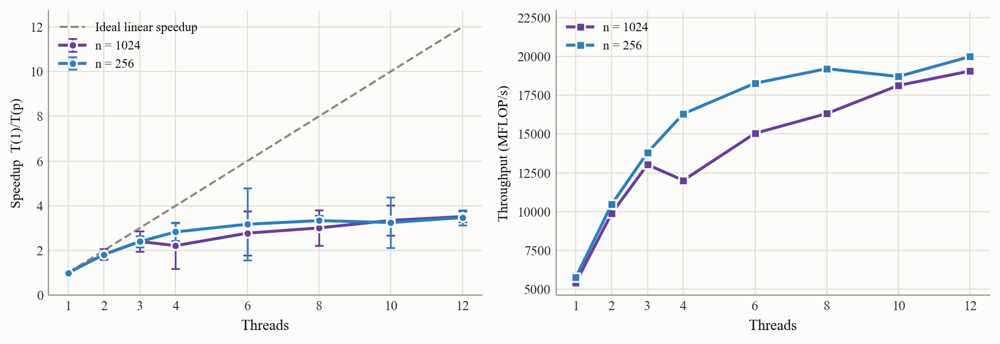
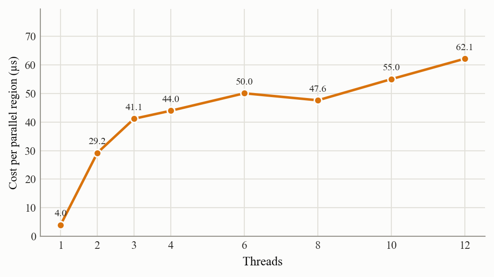
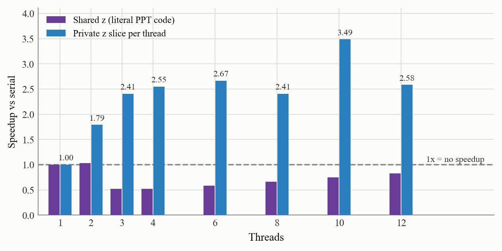

# OpenMP Practice

高性能计算课程**编程作业 3**：用 OpenMP 并行化 DAXPY 与矩阵乘法，考察**外层循环并行 vs 内层循环并行**的差异、线程数扫描的递减收益与多线程开销，并附带并行区开销与缓存行乒乓（false sharing）两个对照实验。

作业要求原文见 `docs/assignment-requirement-{1,2,3}.png`。

---

## 目录结构

```
.
├── omp_daxpy.c            # 任务 1/2：DAXPY，含并行区开销与共享/私有写对照
├── omp_matmul.c           # 任务 2：矩阵乘法（ikj 顺序，并行最外层 i）
├── run_cases.sh           # 跑三个 Case + 正确性验证 -> results/raw/run_cases.txt
├── run_threads.sh         # 线程数扫描 + 开销 + 对照 -> results/raw/run_*.txt（5 个日志）
├── plot_figures.py        # 解析 raw 日志 -> results/*.csv + figures/*.png
├── make_tables.py         # 解析 results/*.csv -> results/tables.md
├── figures/               # 报告插图（5 张）
├── results/               # 汇总数据
│   ├── *.csv              # 脚本生成的中间数据
│   ├── tables.md          # 报告表格（编号从表 5 起，接续前两次作业）
│   └── raw/               # 原始日志（唯一的真·数据源，画图/制表都从它解析）
└── docs/                  # 作业要求截图 + 报告
```

## 环境

| 项 | 值 |
| --- | --- |
| OS | Windows 11 (10.0.22621) |
| CPU | AMD Ryzen 5 5625U（6 核 12 线程） |
| 编译器 | gcc 16.2.0（MinGW-W64 x86_64-ucrt-posix-seh） |
| Python | 3.8 + `matplotlib`（画图） |

两个脚本里 gcc 的路径是**写死的**：

```bash
GCC=${GCC:-/c/mingw64/bin/gcc.exe}
if [ ! -x "$GCC" ]; then GCC=gcc; fi
```

即优先用 `/c/mingw64/bin/gcc.exe`，不存在才退回 PATH 上的 `gcc`。**你的机器上如果 gcc 在别处，用环境变量覆盖**，例如 `GCC=/usr/bin/gcc bash run_cases.sh`。

## 快速开始

```bash
bash run_cases.sh        # 三个 Case 的执行时间 + 正确性验证
bash run_threads.sh      # 线程数扫描、并行区开销、共享写/私有写对照
python plot_figures.py   # 生成 figures/*.png 与 results/*.csv
python make_tables.py    # 生成 results/tables.md
```

> ⚠️ `run_cases.sh` 里 1k×10M 那组的 **Case 3 要跑十几分钟**——它要建立并销毁 10⁷ 个 parallel region，这是该 Case 的结论本身，**不是卡死**。

所有日志带时间戳、CPU 型号、编译器版本、编译参数和电源状态写进 `results/raw/`。跑完 `run_threads.sh` 会把进程优先级提到 High，再画图。

## 作业内容与实现

### 任务 1：DAXPY 的三个 Case

内核是 `z[j] = a*x[j] + y[j]`（`a = 2.0`），外面套 `NUM_LOOP` 次外层循环。三组配置：

| 配置 | VEC_SIZE | NUM_LOOP |
| --- | --- | --- |
| `1k_x10M` | 1024 | 10,000,000 |
| `10k_x100k` | 10000 | 100,000 |
| `100k_x100k` | 100000 | 100,000 |

| Case | 并行策略 | 实现 |
| --- | --- | --- |
| Case 1 | 无多线程 | 双重循环全串行 |
| Case 2 | **外层 i 并行** | `#pragma omp parallel for` 加在外层，全程只有 1 个 parallel region |
| Case 3 | **内层 j 并行** | `#pragma omp parallel for` 加在内层，外层每转一圈就建/拆一个 parallel region |

随机数用固定种子的 LCG（`SEED = 20260924`），保证每次跑的数据完全一致。计时统一用 `omp_get_wtime()`。

### 任务 2：线程数扫描

用 `omp_set_num_threads()` 扫 **1 / 2 / 3 / 4 / 6 / 8 / 10 / 12** 线程，分别测 DAXPY 和矩阵乘法，看递减收益与多线程开销。

矩阵乘法用 **ikj** 循环顺序（k 提到中间、j 最内层），`#pragma omp parallel for` 只加在最外层 i——各线程写 `C` 的不同行，天然无写冲突。这与 DAXPY 的外层并行形成对照。

### 附带实验

* `region`：空跑 `REGION_PROBE = 20000` 个 `#pragma omp parallel` 区域，测**单个并行区的建/拆开销**（µs）。
* `coherence`：**唯一变量是 `z` 共享还是每线程私有**。`kernel_case2` 所有线程写同一个一维 `z`；`kernel_case2p` 用 `#pragma omp parallel` 手工分块、每个线程写自己的 `z` 切片。用来定位任务 2 里"外层并行没有收益"的根因。

## 程序用法

两个可执行文件的子命令（`pmax` 为线程数上限，默认 CPU 核数，上限 16）：

```bash
./omp_daxpy.exe {cases|threads|region|coherence|verify} [pmax]
./omp_matmul.exe check | threads [pmax] [nbig] [nsmall]     # 默认 1024 256
```

| 子命令 | 作用 |
| --- | --- |
| `daxpy verify` | 小规模手算校验 + 三个尺寸下 Case 2/3 与 Case 1 的逐位比对 |
| `daxpy cases` | 任务 1：三组配置 × 三个 Case，各跑 3 轮取最小值（Case 3 只跑 1 次） |
| `daxpy threads` | 任务 2：DAXPY 线程数扫描（三组尺寸 × 8 个线程数 × 5 轮） |
| `daxpy region` | 并行区开销 |
| `daxpy coherence` | 共享写 z vs 每线程私有 z |
| `matmul check` | n = 1/4/64/256 与串行版逐位比对（要求 rel_error 严格为 0） |
| `matmul threads` | 任务 2：矩阵乘法线程数扫描（n=256/1024 × 8 个线程数 × 7 轮） |

## 主要结果

数据取自 `results/tables.md`（接续前两次作业，编号从**表 5** 起），本机**接电源**状态下测得。

### 表 5　三种 Case 的执行时间（12 线程）

| 配置 | Case 1 (s) | Case 2 (s) | Case 3 (s) | Case 2 / Case 1 | Case 3 / Case 1 |
| --- | --- | --- | --- | --- | --- |
| 1k×10M | 3.745 | 4.480 | **740.362** | 1.20× | **197.7×** |
| 10k×100k | 0.352 | 0.201 | 6.743 | 0.57× | 19.2× |
| 100k×100k | 3.982 | 2.577 | 10.233 | 0.65× | 2.6× |

> 后两列是**时间比**（>1 表示更慢），不是加速比。

### 表 6　DAXPY 线程数扫描（外层循环并行）

12 线程时三组尺寸分别为 **0.89× / 1.48× / 2.03×**，最好的点是 100k 那组的 8 线程 **2.38×**。关键是 **1k（L1 常驻）那一列始终 ≤ 1.00×**——小数组上外层并行完全没有收益，见结论 3。

### 表 7　矩阵乘法线程数扫描（并行最外层 i）

12 线程时 n=256 加速 **3.47×**、n=1024 加速 **3.51×**，随线程数单调上升。

### 表 8　并行区开销与共享写/私有写对照

并行区开销从 1 线程的 **4.0 µs** 涨到 12 线程的 **62.1 µs**；共享写 `z` 的加速比始终 **≤ 1.03×**，改成每线程私有切片后最高 **3.49×**。

### 结论

1. **内层循环并行（Case 3）代价极高，且与 `NUM_LOOP` 成正比。** 每转一圈就要建/拆一个 parallel region，1k×10M 要建 10⁷ 个，实测 740.362 s（约 12.3 分钟），是串行的 **197.7 倍**。按 12 线程实测的 62.1 µs/region 估算：10⁷ × 62.1 µs ≈ 621 s，与实测同量级——说明 Case 3 的耗时**基本由建/拆并行区的次数决定，与计算量关系不大**。
2. **总运算量相同、划分方式不同，结果能差 72 倍。** 1k×10M 与 100k×100k 的元素总数几乎一样（1.024e10 vs 1.000e10），Case 1 耗时接近（3.745 s vs 3.982 s），但 Case 3 差了 72 倍（740.362 s vs 10.233 s）。
3. **DAXPY 的外层并行在 L1 常驻的小数组上完全没有收益**（表 6 中 1k 那一列始终 ≤ 1.00×，最低 0.56×）。根因是**所有线程写同一个一维 `z`**，造成缓存行乒乓；`coherence` 对照实验把 `z` 换成每线程私有切片后，加速比从"始终 ≤ 1.03×"抬到"最高 3.49×"，是决定性证据。
4. **矩阵乘法并行最外层 i 则单调加速到 3.51×**——各线程写 `C` 的不同行，没有写冲突。两者对比说明：**并行是否有效，取决于数据依赖与写冲突，而不是循环在哪一层。**

## 图表

**三个 Case 的执行时间（对数轴）**



**DAXPY 线程数扫描：加速比（左）与吞吐量（右）**



**矩阵乘法线程数扫描：加速比（左）与吞吐量（右）**



**单个 parallel region 的开销**



**对照实验：共享写 `z` vs 每线程私有 `z`**



## 测量口径（重要）

1. **两个脚本的编译参数不一样。** `run_cases.sh` 用 `-O2 -fopenmp -fno-tree-vectorize`，`run_threads.sh` 只用 `-O2 -fopenmp`。原因：默认 `-O2` 下 GCC **只自动向量化「串行书写」的内层循环**（本机 SSE2，每次 2 个 double 再展开 2 次），而经过 OpenMP 拐弯之后的 Case 2/3 内层循环保持标量——因为变成 `._omp_fn` 之后编译器丢失了数组指针不相交的信息。不处理的话 Case 1 会凭空获得约 2 倍的机器码优势，把"并行划不划算"这个问题直接带偏（1k×10M 在 `-O2` 下 Case 1 只要 2.708 s、Case 2 要 4.480 s，比值 1.65；统一压成标量后是 3.745 vs 4.480，比值 1.20）。所以**任务 1 的表 5 用 `-fno-tree-vectorize`，保证三个 Case 的机器码可比**；任务 2 是同一内核之间的纵向比较，不受影响。
   → 因此**表 5 的绝对时间与表 6 不是同一份机器码跑出来的，跨表比较要留意口径**。
2. **表 5 的后两列是时间比**（`Case 2 / Case 1` = 4.480/3.745 = 1.20×，表示 Case 2 比 Case 1 慢 1.20 倍），与日志里 `SPEEDUP ... case2_over_case1=0.836` 正好互为倒数。
3. **`coherence` 的基准不能沿用串行版 `kernel_case1`。** 图/表里的共享写与私有写加速比都重新以"同一个内核、1 线程"为基准——理由同第 1 条，串行内核会被自动向量化，两个内核对不上，会出现整段 <1 的假象。
4. **本机满载测量噪声极大**（部分点变异系数到 50%）。对策：进程优先级提到 High、**轮换测量**（每一轮把所有线程数按同一顺序各测一遍，削弱频率漂移）、多轮取均值并画 ±1σ 误差棒。**落在误差内的一律不下结论。**

## 踩过的坑

* **MinGW 是 LLP64，`long` 只有 32 位。** `printf("elements=%ld", vlen*nloop)` 会把 1.024e10 打成 1650065408；跨 32 位的量一律先转 `double`。
* **`Win32_Processor.CurrentClockSpeed` 无论负载轻重都恒定报告标称的 2301 MHz**，量不到实时频率（见 `results/raw/run_freq.txt`：1 线程和 12 线程都是 2301）。所以"全核降频"只能作为推断，不能当实测结论。
* **MinGW 版 libgomp 的 parallel region 开销不低，且随线程数近似线性增长**（4.0 µs @1 线程 → 62.1 µs @12 线程）。Windows 上用事件唤醒，设 `OMP_WAIT_POLICY=passive` 没有改善。
* **`make_tables.py` 只把结果写文件、不打印**——控制台是 GBK，直接 `print` 中文和 `µ` 会抛 `UnicodeEncodeError`。

## 声明

课程作业，仅供学习参考。性能数据强依赖本机（Ryzen 5 5625U / 12 线程 / MinGW gcc 16.2.0）与电源状态，换机器复现值会有出入。
